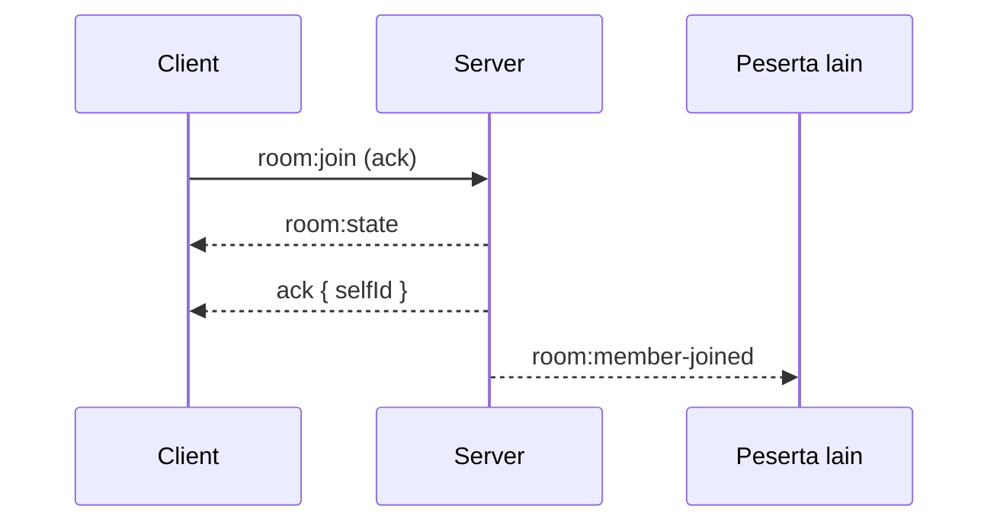
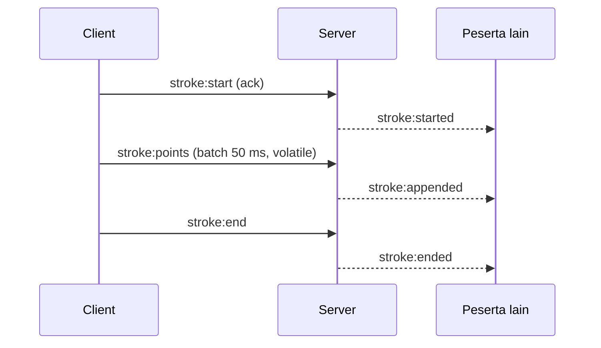
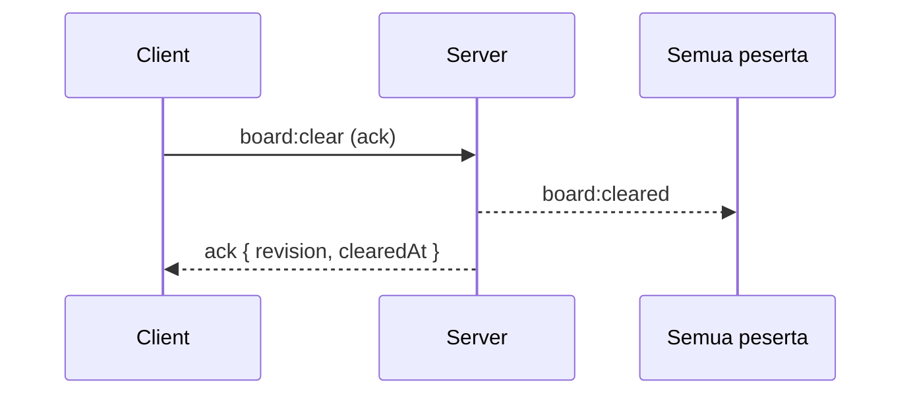

# API & Event Contract — SyncCanvas

Kontrak didefinisikan satu kali di [`packages/shared/src/index.ts`](./packages/shared/src/index.ts) dan dipakai oleh client maupun server. Dokumen ini menjelaskan cara memakainya; bila terjadi perbedaan, **source of truth tetap kode shared**.

## 1. Koneksi

- Transport: Socket.io v4 (WebSocket diutamakan, polling sebagai fallback).
- URL default: `http://localhost:4000` (client: `NEXT_PUBLIC_WS_URL`).
- Path default Socket.io: `/socket.io/`.
- Namespace: `/` (default). Autentikasi namespace belum dipakai.
- Handshake auth (belum diimplementasikan): `{ auth: { token: '<JWT>' } }`, diverifikasi di `io.use()`.

> **Status Sprint 1:** halaman workspace/board sudah dilindungi Auth.js, tetapi koneksi Socket.io masih anonim dan hanya dipakai prototipe `/demo`. Jangan menganggap board ID sebagai otorisasi sampai token board-scoped diterapkan di Sprint 2.

Struktur direktori event:

```
room:join · room:leave · room:state · room:member-joined · room:member-left
stroke:start · stroke:started · stroke:points · stroke:appended · stroke:end · stroke:ended
cursor:move · cursor:update
board:clear · board:cleared
server:error
```

## 2. Envelope hasil (ack)

Semua ack memakai bentuk berikut, tanpa exception:

```json
{ "ok": true, "data": { "selfId": "..." } }
```

```json
{
  "ok": false,
  "error": {
    "code": "VALIDATION_ERROR",
    "message": "Payload tidak valid",
    "details": [{ "path": "roomId", "message": "roomId harus 3-64 karakter..." }]
  }
}
```

Client wajib memeriksa `ok` sebelum memakai `data`. `message` aman ditampilkan untuk kode non-`INTERNAL_ERROR`; `details` hanya untuk debugging.

### Kode error

| Kode                    | Asal   | Arti                                                  |
| ----------------------- | ------ | ----------------------------------------------------- |
| `VALIDATION_ERROR`      | Server | Payload tidak lolos skema Zod                         |
| `NOT_IN_ROOM`           | Server | Socket bukan anggota room yang disebut                |
| `ROOM_NOT_FOUND`        | Server | Room tidak ada (mis. sudah dibersihkan TTL)           |
| `ROOM_FULL`             | Server | Kapasitas member/room di server penuh                 |
| `BOARD_FULL`            | Server | Batas stroke per board atau titik per stroke tercapai |
| `STROKE_NOT_FOUND`      | Server | `strokeId` tidak dikenal                              |
| `STROKE_ALREADY_EXISTS` | Server | `strokeId` duplikat                                   |
| `STROKE_FINISHED`       | Server | Mencoba menambah titik ke stroke yang sudah ditutup   |
| `FORBIDDEN`             | Server | Bukan pembuat stroke                                  |
| `RATE_LIMITED`          | Server | Budget event habis                                    |
| `INTERNAL_ERROR`        | Server | Bug tak terduga; detail hanya di log server           |
| `INVALID_STATE`         | Client | Aksi tidak valid untuk state hook saat ini            |
| `NOT_CONNECTED`         | Client | Socket belum terhubung                                |
| `ACK_TIMEOUT`           | Client | Server tidak membalas dalam 5 detik                   |
| `CONNECTION_ERROR`      | Client | Handshake/transport gagal                             |

## 3. Event: client → server

### `room:join`

Payload:

```json
{ "roomId": "demo-room", "displayName": "Rani" }
```

- `roomId`: 3-64 karakter, `[a-z0-9-]`, diawali/diakhiri huruf/angka.
- `displayName`: 1-32 karakter setelah trim.
- Ack: `{ selfId }`.
- Efek: socket masuk room, menerima `room:state`, peserta lain menerima `room:member-joined`. Satu socket hanya berada di satu room; join ke room lain otomatis meninggalkan room lama.

### `room:leave`

Tanpa payload dan tanpa ack. Peserta lain menerima `room:member-left`.

### `stroke:start`

Payload:

```json
{
  "roomId": "demo-room",
  "strokeId": "0f8c2b1e-6a5f-4f0e-9d1a-2b3c4d5e6f70",
  "tool": "pen",
  "color": "#7c9cff",
  "width": 3,
  "point": { "x": 420.5, "y": 210, "pressure": 0.6 }
}
```

- `tool`: `pen` | `highlighter` | `eraser`.
- `color`: HEX 6 digit.
- `width`: 1-64.
- `point`: koordinat -100000..100000; `pressure` opsional 0..1.
- Ack: `{ strokeId, revision }`.
- Efek: stroke dibuat dan disiarkan ke peserta lain sebagai `stroke:started`.

### `stroke:points`

```json
{
  "roomId": "demo-room",
  "strokeId": "0f8c2b1e-6a5f-4f0e-9d1a-2b3c4d5e6f70",
  "points": [
    { "x": 421, "y": 211 },
    { "x": 423, "y": 214 }
  ]
}
```

- 1-256 titik per event.
- Tanpa ack; relay best-effort dengan `volatile`.
- Ditolak diam-diam (log `debug`) bila stroke sudah selesai atau rate limit habis.

### `stroke:end`

```json
{ "roomId": "demo-room", "strokeId": "0f8c2b1e-6a5f-4f0e-9d1a-2b3c4d5e6f70" }
```

Tanpa ack. Idempotent di server; pengiriman berulang tidak menaikkan `revision` dua kali.

### `cursor:move`

```json
{ "roomId": "demo-room", "x": 512.2, "y": 333.8 }
```

Tanpa ack, tanpa penyimpanan. Disarankan throttle ≤ 20 event/detik (hook sudah melakukannya).

### `board:clear`

```json
{ "roomId": "demo-room" }
```

- Ack: `{ revision, clearedAt }`.
- Efek: semua stroke dihapus dan `board:cleared` disiarkan ke **semua** peserta, termasuk pengirim.

## 4. Event: server → client

| Event                | Payload                          | Kapan                                                      |
| -------------------- | -------------------------------- | ---------------------------------------------------------- |
| `room:state`         | `RoomState` (lihat di bawah)     | Setelah join berhasil; juga titik resync setelah reconnect |
| `room:member-joined` | `RoomMember`                     | Peserta lain join                                          |
| `room:member-left`   | `{ memberId }`                   | Peserta leave/disconnect                                   |
| `stroke:started`     | `Stroke`                         | Peserta lain memulai stroke                                |
| `stroke:appended`    | `{ strokeId, points, revision }` | Batch titik dari peserta lain                              |
| `stroke:ended`       | `{ strokeId, revision }`         | Peserta lain menutup stroke                                |
| `board:cleared`      | `{ by, at, revision }`           | Board dibersihkan (oleh siapa pun)                         |
| `cursor:update`      | `CursorPosition`                 | Peserta lain menggerakkan kursor                           |
| `server:error`       | `AppError`                       | Error pada event tanpa ack (mis. `stroke:end`)             |

### `RoomState`

```json
{
  "roomId": "demo-room",
  "revision": 12,
  "createdAt": 1760000000000,
  "members": [
    { "id": "sK2...", "displayName": "Rani", "color": "#7c9cff", "joinedAt": 1760000000000 }
  ],
  "strokes": [
    {
      "id": "0f8c...",
      "roomId": "demo-room",
      "authorId": "sK2...",
      "tool": "pen",
      "color": "#7c9cff",
      "width": 3,
      "points": [{ "x": 420.5, "y": 210 }],
      "createdAt": 1760000000000,
      "updatedAt": 1760000000000,
      "finishedAt": null
    }
  ]
}
```

Catatan:

- `revision` naik pada perubahan struktural: stroke baru, stroke selesai, clear board. Append titik tidak menaikkannya.
- `finishedAt: null` menandakan stroke masih berjalan; snapshot tetap menyertakannya.
- `authorId` adalah `socket.id` (identitas anonim), bukan user ID permanen.

## 5. Urutan event

### Join



### Menggambar



Pengirim tidak menerima echo. Bila `stroke:start` gagal, client menghapus stroke optimistisnya.

### Clear board



## 6. Batasan & rate limit

| Batas                | Nilai          | Catatan                       |
| -------------------- | -------------- | ----------------------------- |
| Titik per event      | 256            | `MAX_POINTS_PER_BATCH`        |
| Titik per stroke     | 20.000         | Server menolak (`BOARD_FULL`) |
| Stroke per room      | 2.000          | `MAX_STROKES_PER_ROOM`        |
| Peserta per room     | 50             | `MAX_ROOM_MEMBERS`            |
| Room per instance    | 500            | `MAX_ROOMS`                   |
| Budget real-time     | 60 event/detik | Kursor & titik; token bucket  |
| Budget write         | 30 event/detik | Join, start/end stroke, clear |
| Ack timeout (client) | 5 detik        | `ACK_TIMEOUT`                 |
| Umur room kosong     | 30 menit       | `ROOM_IDLE_TTL_MS`            |

## 7. HTTP endpoints

| Method | Path      | Fungsi                | Contoh respons                                                                |
| ------ | --------- | --------------------- | ----------------------------------------------------------------------------- |
| `GET`  | `/health` | Liveness              | `{ "status": "ok", "uptimeSeconds": 42, "timestamp": "..." }`                 |
| `GET`  | `/ready`  | Readiness + statistik | `{ "status": "ready", "rooms": { "rooms": 1, "members": 2, "strokes": 14 } }` |

Endpoint lain mengembalikan `404`:

```json
{ "error": { "code": "NOT_FOUND", "message": "Endpoint tidak ditemukan" } }
```

## 8. Kompatibilitas

- Nama event dan bentuk payload adalah API publik. Perubahan aditif (field opsional baru) diperbolehkan dalam versi minor.
- Perubahan breaking (rename event, hapus field, ubah tipe) harus melalui namespace baru (`/v2`) atau versi mayor paket.
- Client dan server wajib memakai versi `@synccanvas/shared` yang sama; jaga agar keduanya di-deploy bersamaan.
