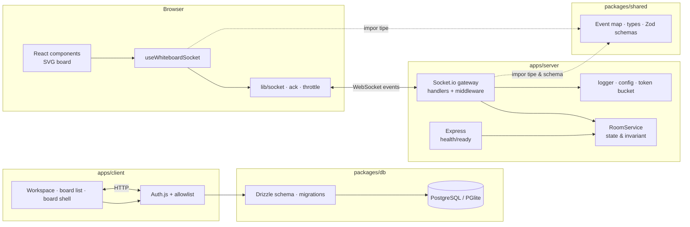

# Arsitektur SyncCanvas

Dokumen ini menjelaskan bagaimana proyek disusun, mengapa keputusan teknis diambil, dan bagaimana sistem berkembang dari MVP satu instance menjadi layanan multi-instance.

## 1. Tujuan & non-tujuan

**Tujuan MVP**

- Kolaborasi real-time yang terasa instan (coretan lokal tidak menunggu server).
- Kontrak client/server tunggal yang tervalidasi saat runtime dan saat compile.
- Pemisahan tegas antara UI, transport real-time, domain, dan infrastruktur.
- Aman terhadap input nakal dasar: payload invalid, flooding, dan lonjakan memori.
- Bisa dijalankan lokal dengan satu perintah.

**Non-tujuan (belum di MVP)**

- Persistensi permanen dan riwayat versi board.
- Multi-instance/horizontal scaling.
- Autentikasi & otorisasi per peran.
- Offline editing dan resolusi konflik (CRDT/OT).
- Renderer berperforma tinggi untuk puluhan ribu titik.

Semua non-tujuan punya jalur ekstensi yang dijelaskan di bagian [Roadmap teknis](#roadmap-teknis).

## 2. Gambaran sistem



Aliran request selalu satu arah per lapisan:

```
UI event → hook (optimistic + throttle/batch) → socket event
        → handler (validasi → otorisasi → rate limit)
        → RoomService (invariant + state)
        → broadcast ke peserta lain → hook menerapkan ke state React
```

## 3. Struktur folder

```text
sync-canvas/
├─ apps/
│  ├─ client/                              # Next.js App Router + Auth.js
│  │  ├─ src/
│  │  │  ├─ app/                           # Routing, guard, server actions
│  │  │  │  ├─ layout.tsx                  # Root layout, metadata, CSS global
│  │  │  │  ├─ page.tsx                    # Redirect ke workspace / login
│  │  │  │  ├─ login/                      # Halaman & action login
│  │  │  │  ├─ w/[slug]/                   # Workspace + board list/CRUD
│  │  │  │  ├─ w/[slug]/b/[boardId]/       # Board shell (editor Sprint 2)
│  │  │  │  ├─ demo/                       # Prototipe realtime terproteksi
│  │  │  │  └─ api/auth/[...nextauth]/     # Handler Auth.js
│  │  │  ├─ auth.ts                        # Konfigurasi NextAuth + allowlist
│  │  │  ├─ components/                    # Komponen presentasional & fitur
│  │  │  │  └─ whiteboard-demo.tsx         # Input pointer, toolbar, render SVG
│  │  │  ├─ hooks/                         # Orkestrasi state & efek
│  │  │  │  └─ use-whiteboard-socket.ts    # Lifecycle socket, sync state, batching
│  │  │  └─ lib/                           # Akses, DB guard, utilitas UI
│  │  │     ├─ access.ts                   # Allowlist fail-closed
│  │  │     ├─ workspace.ts                # Workspace/board access queries
│  │  │     ├─ require-user.ts             # Guard session server-side
│  │  │     ├─ socket.ts
│  │  │     ├─ ack.ts
│  │  │     └─ throttle.ts
│  │  ├─ next-env.d.ts
│  │  ├─ next.config.ts
│  │  └─ .env.example
│  └─ server/                              # Node.js + Express + Socket.io
│     ├─ src/
│     │  ├─ config/env.ts                  # Validasi env terpusat (fail fast)
│     │  ├─ lib/                           # logger · token-bucket
│     │  ├─ services/room.service.ts       # Domain realtime in-memory
│     │  ├─ socket/                        # handlers · middleware · wiring
│     │  ├─ app.ts
│     │  ├─ index.ts
│     │  └─ types.ts
│     ├─ tsconfig.json
│     └─ .env.example
├─ packages/
│  ├─ db/                                  # Drizzle ORM + PostgreSQL
│  │  ├─ src/
│  │  │  ├─ schema.ts                      # Auth.js + workspace/board/element
│  │  │  ├─ index.ts                       # postgres.js client (pool max 1)
│  │  │  └─ migrate.ts                     # Runner migration
│  │  ├─ drizzle/                          # SQL migration ter-commit
│  │  └─ drizzle.config.ts
│  └─ shared/                              # Satu sumber kebenaran kontrak
│     ├─ src/index.ts
│     └─ tsconfig.json
├─ scripts/                                # Helper dev PGlite
├─ package.json
├─ tsconfig.base.json
├─ README.md
├─ ARCHITECTURE.md
├─ API_DOCS.md
└─ CONTRIBUTING.md
```

### Tanggung jawab per direktori

| Direktori          | Boleh tahu tentang                            | Tidak boleh tahu tentang | Isi khas                              |
| ------------------ | --------------------------------------------- | ------------------------ | ------------------------------------- |
| `app/`             | Routing, metadata, komposisi halaman          | Detail Socket.io         | Halaman, layout, server action, guard |
| `auth.ts`          | Provider, session, allowlist                  | UI                       | Konfigurasi Auth.js                   |
| `components/`      | Props, event UI, rendering                    | Cara event dikirim       | Toolbar, board, dialog                |
| `hooks/`           | Socket client, state React, lifecycle         | Styling                  | `useWhiteboardSocket`                 |
| `lib/` (client)    | Browser API, DB access, utilitas murni        | Komponen React           | `access`, `workspace`, `socket`       |
| `socket/handlers/` | Payload tervalidasi, `RoomService`, broadcast | Renderer/UI              | Handler per domain                    |
| `services/`        | Invariant domain, struktur data               | Socket, Express          | `RoomService`                         |
| `lib/` (server)    | API Node, algoritma generik                   | Domain whiteboard        | Logger, token bucket                  |
| `config/`          | `process.env`                                 | Domain                   | Env tervalidasi                       |
| `packages/db`      | Skema, migration, client PostgreSQL           | UI, Socket.io            | Tabel Auth.js, workspace, board       |
| `packages/shared`  | Kontrak lintas runtime                        | Implementasi/IO          | Tipe, event map, skema Zod            |

Aturan dependensi: `app → components → hooks → lib`, dan `handlers → services`. Tidak ada arah sebaliknya. `shared` boleh diimpor siapa pun, tetapi tidak boleh mengimpor kode aplikasi. Hanya server component/server action yang boleh mengimpor `packages/db`; jangan pernah mengimpor DB client dari client component.

## 4. Model data

```ts
Room {
  id, createdAt, revision, lastActivityAt,
  members: Map<socketId, RoomMember>,
  strokes: Map<strokeId, Stroke>
}

Stroke {
  id, roomId, authorId, tool, color, width,
  points: Point[], createdAt, updatedAt, finishedAt
}
```

- **Satu socket = satu room.** Perpindahan room otomatis meninggalkan room lama dan memberi notifikasi presence.
- **`revision`** naik pada perubahan struktural (stroke mulai, stroke selesai, clear board). Titik yang di-append tidak menaikkannya karena hanya memperpanjang stroke yang sudah ada. Nilai ini berguna untuk debugging urutan event dan audit ringan.
- **`finishedAt === null`** berarti stroke masih aktif. Snapshot bisa berisi stroke setengah jadi; peserta baru tetap melihat coretan yang sedang berjalan.
- **Room kosong dipertahankan** selama `ROOM_IDLE_TTL_MS` agar reconnect/refresh tidak menghapus board. Pembersihan dilakukan `sweepIdleRooms()` berkala.
- **Batas keras** melindungi memori: 256 titik per batch, 20.000 titik per stroke, 2.000 stroke per room, 50 peserta per room.

## 5. Alur runtime

### 5.1 Join & sinkronisasi awal

1. Client menghubungkan socket (`autoConnect: false`, dibuka eksplisit oleh hook).
2. Client mengirim `room:join` dengan ack dan timeout 5 detik.
3. Server memvalidasi payload, memeriksa kapasitas, mencatat member, lalu `socket.join(roomId)`.
4. Server mengirim `room:state` ke socket tersebut, `room:member-joined` ke peserta lain, dan ack `{ selfId }`.
5. Client mengganti seluruh state lokal dengan snapshot. Ini juga jalur resync setelah reconnect.

Snapshot sengaja dikirim sebagai event, bukan bagian ack, agar hanya ada **satu** jalur penerapan state (`room:state`) dan payload ack tetap kecil.

### 5.2 Menggambar

1. `pointerdown` → client membuat UUID, menyisipkan stroke optimistis, lalu mengirim `stroke:start`.
2. `pointermove` → titik ditambahkan ke state lokal, dimasukkan buffer, dan di-commit ke React maksimal sekali per frame.
3. Setiap 50 ms buffer dikirim sebagai `stroke:points` (maks. 256 titik). Server memvalidasi, memastikan pengirim adalah pembuat stroke, menyimpan, lalu meneruskan dengan `volatile` ke peserta lain.
4. `pointerup` → sisa buffer di-flush, lalu `stroke:end`. Urutan TCP menjamin titik tiba sebelum `end`, sehingga tidak perlu ack tambahan.
5. Pengirim tidak menerima echo; server hanya menyiarkan ke `socket.to(room)`. Jika `stroke:start` gagal, client melakukan rollback agar tidak ada "coretan hantu".

### 5.3 Kursor

- Client mengirim `cursor:move` maksimal 20x/detik dengan throttle leading+trailing.
- Server tidak menyimpan kursor; hanya relay (tanpa ack) dan menghitung budget rate limit.
- Client penerima menyimpan kursor di ref, commit per frame, dan membuang kursor yang tidak diperbarui selama 8 detik.
- Saat participant leave, kursornya langsung dihapus.

### 5.4 Clear, leave, disconnect

- `board:clear` memerlukan ack, disiarkan ke **semua** peserta (termasuk pengirim) agar semua client mengosongkan board.
- `room:leave` dan `disconnect` memakai satu jalur `leaveCurrentRoom()` sehingga presence selalu konsisten.
- Saat server shutdown, `io.close()` memutus socket dan menutup HTTP server; ada timer 10 detik untuk memaksa keluar bila koneksi macet.

### 5.5 Reconnect

Socket.io menyambung ulang dengan backoff. Setiap `connect` memicu join ulang karena `socket.id` berubah; snapshot server menimpa state lokal. Stroke yang dibuat saat offline tidak diantrikan — ini konsekuensi optimistic UI tanpa offline queue, dan alasan CRDT/outbox menjadi roadmap.

## 6. Keputusan desain

| Keputusan                         | Alternatif                           | Alasan                                                   | Konsekuensi                                          |
| --------------------------------- | ------------------------------------ | -------------------------------------------------------- | ---------------------------------------------------- |
| Monorepo npm workspaces           | Dua repo terpisah                    | Kontrak berubah dalam satu commit, satu `npm install`    | Perlu build `shared` sebelum app berjalan            |
| Zod + tipe turunan di `shared`    | Interface manual + validasi terpisah | Skema dan tipe tidak bisa drift                          | Ukuran bundle client sedikit bertambah               |
| `Result<T>` untuk ack             | `throw` / string error               | Error terduga tidak melempar; UI bisa menangani per kode | Sedikit lebih verbose di call site                   |
| Optimistic UI                     | Tunggu konfirmasi server             | Latensi gambar terasa instan                             | Perlu rollback saat gagal                            |
| Snapshot lewat `room:state`       | State di dalam ack join              | Satu jalur apply state, cocok untuk resync               | Client harus memasang listener sebelum join          |
| `volatile` untuk titik            | Reliable emit                        | Mencegah antrean menumpuk saat jaringan buruk            | Sebagian batch bisa hilang (dapat diterima)          |
| Batching 50 ms + commit per frame | Kirim per pointermove                | Mengurangi event 2-5x tanpa terasa                       | Titik Remote sedikit tertinggal (<100 ms)            |
| In-memory `Map`                   | Postgres/Redis sejak awal            | Validasi produk cepat, tanpa infra                       | State hilang saat restart, tidak bisa multi-instance |
| Token bucket per socket           | Fixed window / global limit          | Tidak ada burst di batas window, adil per koneksi        | Perlu tuning kapasitas                               |
| Satu socket satu room             | Multi-room per socket                | Presence & otorisasi sederhana                           | Tidak bisa menerima notifikasi room lain             |
| Error boundary per event          | Biarkan proses crash                 | Satu bug tidak menjatuhkan semua peserta                 | Error harus tetap dipantau lewat log                 |

## 7. Roadmap teknis

### 7.1 Multi-instance

1. Tambahkan `@socket.io/redis-adapter` agar broadcast antar node.
2. Aktifkan sticky session di load balancer (wajib bila polling dipakai) atau paksa `transports: ['websocket']`.
3. Pindahkan `RoomService` ke Redis/Postgres. State per room harus bisa dibaca semua node; jangan hanya mengandalkan adapter (adapter menyiarkan event, bukan menyimpan board).
4. Partisi berdasarkan `roomId` bila skala terus naik.

### 7.2 Persistensi & riwayat

- Simpan stroke sebagai row (`id, room_id, author_id, tool, color, width, points JSONB, created_at, finished_at`).
- Tulis batch titik secara periodik, bukan per batch, untuk mengurangi write amplification.
- Untuk undo/redo dan offline, pertimbangkan CRDT (Yjs/Automerge) atau operation log dengan kompensasi.
- Snapshot berkala + event log memungkinkan replay dan audit.

### 7.3 Autentikasi & otorisasi

- Verifikasi JWT di `io.use()` dari `socket.handshake.auth.token`; isi `socket.data.userId` dari token, bukan `randomUUID()`.
- Tambahkan peran per room (`owner`, `editor`, `viewer`); `board:clear` dan `stroke:*` perlu cek peran.
- Gunakan room ID acak/tidak mudah ditebak, atau undangan bertoken.
- Terapkan batas ukuran room berdasarkan paket pengguna.

### 7.4 Performa renderer

- SVG saat ini cukup untuk demo dan board kecil. Untuk puluhan ribu titik, pindah ke canvas 2D/WebGL.
- Simpan titik dalam typed array, gambar per frame, dan gunakan spatial index untuk eraser/hit-testing.
- Pertimbangkan interpolasi (quadratic curve) agar garis halus dengan data lebih sedikit.

## 8. Keamanan

| Risiko                    | Mitigasi saat ini                                                                 | Langkah produksi                                         |
| ------------------------- | --------------------------------------------------------------------------------- | -------------------------------------------------------- |
| Payload invalid/berbahaya | Zod di server, batas koordinat, regex warna, UUID, batas batch                    | Pertahankan; tambahkan fuzzing test                      |
| Flooding event            | Token bucket per socket, `volatile` untuk stream                                  | Metrics rate-limit hits + auto-tune                      |
| Spoofing room             | Otorisasi memakai `socket.data.roomId`, bukan payload                             | JWT + ACL                                                |
| Memory exhaustion         | Batas room/member/stroke/titik, TTL room idle                                     | Monitoring memori + eviction LRU                         |
| XSS lewat nama            | React meng-escape `displayName`; renderer hanya memakai angka & warna tervalidasi | Sanitasi tambahan bila memakai `dangerouslySetInnerHTML` |
| CORS                      | Allow-list origin untuk HTTP & handshake                                          | Jangan pernah `*` di produksi                            |
| Eavesdropping             | — (butuh TLS)                                                                     | Terminasi TLS di reverse proxy, HSTS                     |
| Akses anonim              | Semua peserta bisa clear board                                                    | Peran + audit log                                        |

CORS bukan mekanisme autentikasi: client non-browser dapat memanggil server langsung. Validasi dan otorisasi tetap dilakukan di server.

## 9. Observability

- Log JSON per baris (`logger.ts`) dengan field kontekstual: `roomId`, `socketId`, `displayName`, `revision`.
- `GET /health` untuk liveness, `GET /ready` untuk readiness + statistik ringan (`rooms`, `members`, `strokes`).
- Kandidat metrik berikutnya: jumlah socket aktif, latensi event, batch yang di-drop, rate-limit hits, ukuran board per room.
- Jangan pernah mencatat isi stroke atau token; cukup metadata.

## 10. Strategi pengujian

| Level       | Cakupan                                                                             | Alat yang disarankan      |
| ----------- | ----------------------------------------------------------------------------------- | ------------------------- |
| Unit        | `TokenBucket`, `RoomService` (kapasitas, ownership, idempotensi end, TTL)           | `node:test` atau Vitest   |
| Integration | Join → state → stroke → broadcast → leave memakai dua `socket.io-client` in-process | Vitest + Socket.io client |
| Contract    | Setiap schema Zod menerima payload valid & menolak kasus batas                      | Vitest                    |
| E2E         | Dua browser context menggambar bersamaan, reconnect, clear                          | Playwright                |
| Manual      | Dua tab, matikan server saat menggambar lalu nyalakan lagi                          | Checklist PR              |

## 11. Menambah fitur baru

Urutan yang menjaga arsitektur tetap bersih:

1. Definisikan payload & schema di `packages/shared`.
2. Tambahkan method domain di `RoomService` beserta invariant-nya.
3. Buat handler tipis di `socket/handlers/*` (validasi → otorisasi → rate limit → service → broadcast).
4. Tambahkan action/state di hook client, jangan di komponen.
5. Perbarui `API_DOCS.md` dan `README.md` bila alur berubah.
6. Tambahkan test untuk kasus sukses, input invalid, dan akses tidak sah.
