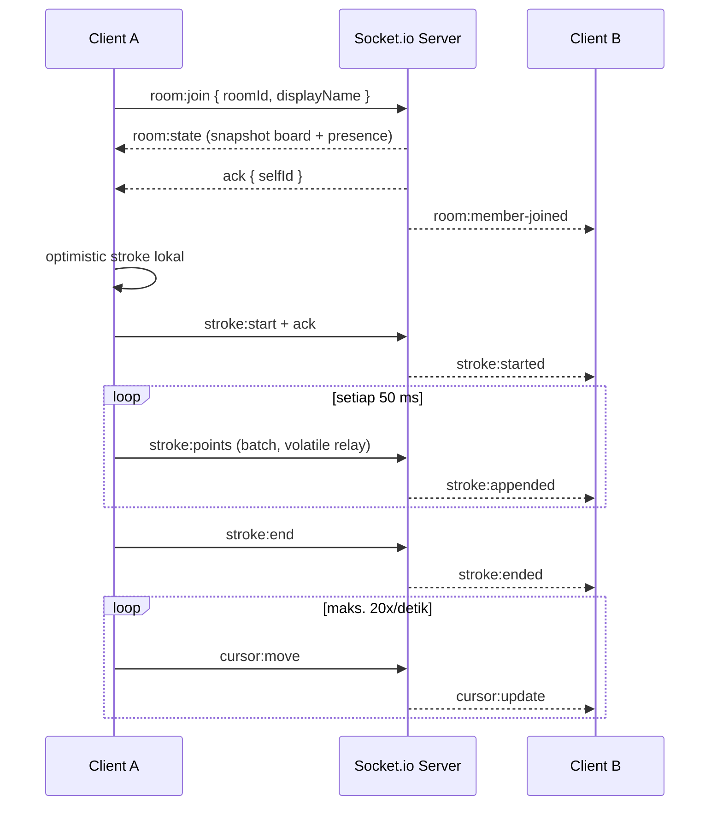

# SyncCanvas

Whiteboard kolaboratif real-time: beberapa orang menggambar di board yang sama, melihat coretan dan kursor satu sama lain tanpa refresh.

Proyek ini adalah **monorepo npm workspaces** dengan empat paket:

| Paket             | Teknologi                         | Peran                                            |
| ----------------- | --------------------------------- | ------------------------------------------------ |
| `apps/client`     | Next.js 15 (App Router), React 19 | UI, Auth.js, workspace, board management         |
| `apps/server`     | Node.js, Express, Socket.io       | Relay event real-time, state room, validasi      |
| `packages/db`     | Drizzle ORM + PostgreSQL          | Skema auth/workspace/board, migration, DB client |
| `packages/shared` | TypeScript + Zod                  | Kontrak event & tipe yang dipakai kedua sisi     |

## Status pengembangan

**Sprint 1 selesai:** autentikasi Google (allowlist email), workspace default, board list, dan board CRUD. Halaman board saat ini adalah fondasi terproteksi; editor realtime dan persistensi coretan masuk Sprint 2.

Prototipe realtime anonim tetap tersedia di `/demo` (butuh login) untuk memvalidasi alur Socket.io yang sudah ada.

### Fitur Sprint 1

- Login Google lewat Auth.js v5 + Drizzle adapter.
- Allowlist akses **fail-closed** melalui `ALLOWED_EMAILS` / `ALLOWED_EMAIL_DOMAINS`.
- Login development tanpa Google OAuth (hanya `AUTH_DEV_LOGIN=true` dan non-production).
- Workspace default otomatis; pengguna pertama menjadi `OWNER`, anggota allowlisted berikutnya `MEMBER`.
- Board list, buat board, ubah judul, dan hapus board dengan otorisasi per workspace.
- Guard server-side di layout, page, dan server action — bukan hanya menyembunyikan UI.
- Database lokal sekali jalan memakai PGlite (tanpa Docker/Neon).

### Prototipe realtime (`/demo`)

- Menggambar stroke (pen & highlighter) dengan optimistic update.
- Sinkronisasi stroke ke semua peserta room, termasuk peserta yang join di tengah sesi (`room:state`).
- Kursor peserta lain dengan throttle 20 event/detik dan pembersihan otomatis saat idle.
- Presence, clear board, validasi Zod, rate limiting, error boundary per event.
- Reconnect otomatis dengan join ulang dan snapshot state terbaru.

> **Status:** fondasi produksi, bukan aplikasi final. Otorisasi socket, persistensi coretan, sticky notes, dan scaling multi-instance masih roadmap — lihat [ROADMAP.md](./ROADMAP.md).

## Prasyarat

- **Node.js ≥ 20.11** (disarankan 22 LTS)
- **npm ≥ 10** (ikut terpasang dengan Node)
- Browser modern (Chrome/Edge/Firefox/Safari) dengan dukungan WebSocket & Pointer Events
- Port `3000` (client), `4000` (server), dan `5433` (PGlite lokal) tersedia
- Untuk produksi: PostgreSQL (Neon), Google OAuth client, dan secret `AUTH_SECRET`

> Windows: jika `npm` gagal dengan pesan `npm.ps1 cannot be loaded because running scripts is disabled`, gunakan `npm.cmd` atau jalankan `Set-ExecutionPolicy -Scope CurrentUser RemoteSigned` di PowerShell.

## Instalasi & menjalankan (lokal)

```bash
# 1. Install seluruh workspace
npm install

# 2. Siapkan environment
#    Windows PowerShell
Copy-Item apps/server/.env.example apps/server/.env
Copy-Item apps/client/.env.example apps/client/.env.local
#    macOS/Linux
# cp apps/server/.env.example apps/server/.env
# cp apps/client/.env.example apps/client/.env.local

# 3. Isi AUTH_SECRET dan ALLOWED_EMAILS di apps/client/.env.local
#    AUTH_SECRET bisa dibuat dengan:
node -e "console.log(require('crypto').randomBytes(32).toString('base64'))"

# 4. Jalankan database lokal (PGlite) + migration + client + server
npm run dev:local
```

Buka <http://localhost:3000>. `npm run dev:local` melakukan semuanya:

1. build `packages/shared` dan `packages/db`,
2. membuat `.data/pglite` (database PostgreSQL tertanam, tanpa Docker),
3. menjalankan migration Drizzle,
4. menyalakan Socket.io server di `http://localhost:4000` dan Next.js di `http://localhost:3000`.

Karena Google OAuth belum tentu dikonfigurasi, aktifkan login development di `.env.local`:

```dotenv
AUTH_DEV_LOGIN=true
ALLOWED_EMAILS=nama@perusahaan.com
```

Form “Masuk sebagai developer” hanya muncul saat `AUTH_DEV_LOGIN=true` **dan** `NODE_ENV !== production`. Login ini akan membuat user di database lalu menjalankan alur workspace yang sama dengan Google.

### Login Google (produksi/lokal)

1. Buat OAuth Client ID tipe **Web application** di Google Cloud Console.
2. Tambahkan Authorized redirect URI:
   - lokal: `http://localhost:3000/api/auth/callback/google`
   - produksi: `https://<domain-vercel>/api/auth/callback/google`
3. Isi `AUTH_GOOGLE_ID` dan `AUTH_GOOGLE_SECRET` di `apps/client/.env.local` (atau environment Vercel).
4. Isi `ALLOWED_EMAILS` dengan email yang diizinkan. Untuk domain Google Workspace, `ALLOWED_EMAIL_DOMAINS=perusahaan.com` juga bisa dipakai.

> Email yang diberikan saat ini (`@gmail.com`) **bukan** domain Google Workspace. Karena itu akses memakai allowlist email persis, bukan pembatasan domain.

### Memakai PostgreSQL/Neon

```bash
# isi DATABASE_URL di apps/client/.env.local dan apps/server/.env
npm run db:migrate
npm run dev
```

`npm run db:migrate` menerapkan SQL migration dari `packages/db/drizzle` memakai driver yang sama dengan aplikasi (`postgres.js`). Tidak ada perbedaan dialek antara lokal dan produksi.

### Menjalankan terpisah

```bash
npm run build:packages
npm run db:migrate
npm run dev -w @synccanvas/server
npm run dev -w @synccanvas/client
```

Jika `packages/shared` atau `packages/db` diubah saat dev berjalan, jalankan `npm run build:packages` lalu restart proses yang memakainya.

## Scripts

Dijalankan dari root:

| Script                 | Fungsi                                                           |
| ---------------------- | ---------------------------------------------------------------- |
| `npm run dev`          | Build packages + jalankan server & client (butuh `DATABASE_URL`) |
| `npm run dev:local`    | PGlite lokal + migration + server & client (tanpa Docker/Neon)   |
| `npm run build`        | Build shared → db → server → client                              |
| `npm start`            | Jalankan hasil build (server `dist` + `next start`)              |
| `npm run typecheck`    | Typecheck keempat paket                                          |
| `npm run db:generate`  | Generate SQL migration dari `packages/db/src/schema.ts`          |
| `npm run db:migrate`   | Terapkan migration ke `DATABASE_URL`                             |
| `npm run format`       | Prettier seluruh repo                                            |
| `npm run format:check` | Cek format tanpa menulis                                         |

## Environment variables

### `apps/server/.env`

| Variabel                    | Default                 | Keterangan                            |
| --------------------------- | ----------------------- | ------------------------------------- |
| `NODE_ENV`                  | `development`           | `development` / `test` / `production` |
| `PORT`                      | `4000`                  | Port HTTP + WebSocket                 |
| `LOG_LEVEL`                 | `info`                  | `debug` / `info` / `warn` / `error`   |
| `CORS_ORIGINS`              | `http://localhost:3000` | Origin diizinkan, pisah koma          |
| `MAX_ROOMS`                 | `500`                   | Batas room per instance               |
| `MAX_ROOM_MEMBERS`          | `50`                    | Batas peserta per room                |
| `MAX_STROKES_PER_ROOM`      | `2000`                  | Batas stroke per board                |
| `ROOM_IDLE_TTL_MS`          | `1800000`               | Umur room kosong sebelum dibersihkan  |
| `ROOM_SWEEP_INTERVAL_MS`    | `60000`                 | Interval pembersihan room idle        |
| `RATE_LIMIT_CURSOR_PER_SEC` | `60`                    | Budget event real-time per socket     |
| `RATE_LIMIT_WRITE_PER_SEC`  | `30`                    | Budget event penulisan per socket     |

### `apps/client/.env.local`

| Variabel                 | Default                 | Keterangan                                                              |
| ------------------------ | ----------------------- | ----------------------------------------------------------------------- |
| `NEXT_PUBLIC_WS_URL`     | `http://localhost:4000` | URL Socket.io server. Hanya `NEXT_PUBLIC_*` yang sampai ke browser.     |
| `AUTH_SECRET`            | —                       | **Wajib.** Secret Auth.js; buat dengan `node -e "..."` (lihat di atas). |
| `AUTH_GOOGLE_ID`         | —                       | Client ID Google OAuth.                                                 |
| `AUTH_GOOGLE_SECRET`     | —                       | Client secret Google OAuth.                                             |
| `ALLOWED_EMAILS`         | —                       | Daftar email allowlisted, pisah koma. Kosong = semua ditolak.           |
| `ALLOWED_EMAIL_DOMAINS`  | —                       | Domain yang diizinkan (tanpa `@`), untuk Google Workspace.              |
| `AUTH_DEV_LOGIN`         | `false`                 | `true` mengaktifkan login kredensial **hanya** di non-production.       |
| `DEFAULT_WORKSPACE_SLUG` | `internal`              | Slug workspace default.                                                 |
| `DEFAULT_WORKSPACE_NAME` | `SyncCanvas Internal`   | Nama workspace default.                                                 |
| `DATABASE_URL`           | —                       | PostgreSQL/Neon. Di lokal diisi otomatis oleh `npm run dev:local`.      |

Seluruh nilai server divalidasi saat bootstrap (`apps/server/src/config/env.ts`). Env yang salah membuat proses berhenti dengan pesan yang jelas alih-alih gagal diam-diam.

## Alur data WebSocket (singkat)



Prinsipnya:

1. **Join** — server mengirim `room:state` (semua stroke + peserta) sebagai satu-satunya jalur sinkronisasi awal.
2. **Menggambar** — client menggambar secara optimistis, server memvalidasi, menyimpan, lalu meneruskan ke peserta lain. Pengirim tidak menerima echo.
3. **Titik** — dikumpulkan 50 ms lalu dikirim sebagai batch; relay memakai `volatile` agar latensi tidak menumpuk.
4. **Kursor** — di-throttle 50 ms di client, dibatasi token bucket di server, dan dihapus dari layar setelah 8 detik idle.
5. **Reconnect** — Socket.io menyambung ulang, client join lagi, `room:state` menimpa state lokal.

Detail kontrak event, payload, dan kode error: [API_DOCS.md](./API_DOCS.md).

## Build & produksi

```bash
npm ci
npm run build

# Terminal 1
NODE_ENV=production npm run start -w @synccanvas/server

# Terminal 2
npm run start -w @synccanvas/client
# atau: npm start   (keduanya sekaligus)
```

Checklist produksi:

- Set `AUTH_SECRET` (minimal 32 byte acak) di environment Vercel.
- Set `AUTH_GOOGLE_ID` / `AUTH_GOOGLE_SECRET` dan tambahkan redirect URI produksi.
- Set `ALLOWED_EMAILS` dan/atau `ALLOWED_EMAIL_DOMAINS`. Jangan biarkan kosong.
- Set `DATABASE_URL` Neon di Vercel **dan** Fly.io; jalankan `npm run db:migrate` saat deploy.
- Biarkan `AUTH_DEV_LOGIN` tidak di-set/false.
- Set `CORS_ORIGINS` ke origin HTTPS yang sebenarnya (jangan `*`).
- Set `NEXT_PUBLIC_WS_URL`. Nilai ini **di-inline saat build**, jadi build ulang client bila berubah.
- Letakkan reverse proxy (Nginx/Caddy/Traefik) di depan server Fly.io dan teruskan header upgrade WebSocket (`Upgrade`, `Connection`) untuk path `/socket.io/`.
- Jalankan satu instance server terlebih dahulu. Untuk lebih dari satu instance, baca bagian scaling di [ARCHITECTURE.md](./ARCHITECTURE.md#scaling-path).
- Otorisasi socket dan persistensi coretan dikerjakan Sprint 2; jangan membuka `/demo` sebagai fitur produksi sebelum itu.

## Troubleshooting

| Gejala                                    | Penyebab umum                             | Solusi                                                           |
| ----------------------------------------- | ----------------------------------------- | ---------------------------------------------------------------- |
| `blocked by CORS policy`                  | `CORS_ORIGINS` tidak memuat origin client | Samakan origin persis (skema + host + port), lalu restart server |
| Status berputar di "Menghubungkan…"       | Server belum jalan / URL salah            | Cek `NEXT_PUBLIC_WS_URL` dan `http://localhost:4000/health`      |
| `Cannot find module '@synccanvas/shared'` | Package belum dibuild                     | `npm run build:packages`                                         |
| `MissingSecret` / login gagal             | `AUTH_SECRET` kosong                      | Isi di `.env.local`, restart Next.js                             |
| Login ditolak padahal email benar         | Allowlist kosong / beda huruf             | Isi `ALLOWED_EMAILS`; pencocokan case-insensitive                |
| Form developer tidak muncul               | Mode production / flag mati               | Gunakan `next dev` + `AUTH_DEV_LOGIN=true`                       |
| `ECONNREFUSED 127.0.0.1:5433`             | PGlite belum jalan                        | Jalankan lewat `npm run dev:local`, bukan `npm run dev`          |
| Migration gagal                           | `DATABASE_URL` salah / DB belum siap      | Cek koneksi Neon, lalu `npm run db:migrate`                      |
| WebSocket gagal di balik proxy            | Header upgrade tidak diteruskan           | Aktifkan WebSocket support + `proxy_read_timeout` yang cukup     |
| Board hilang setelah restart server       | State in-memory (prototipe `/demo`)       | Persistensi realtime masuk Sprint 2                              |
| `npm.ps1 cannot be loaded` (Windows)      | Execution policy                          | Pakai `npm.cmd` atau ubah execution policy                       |

## Dokumentasi lain

- [ARCHITECTURE.md](./ARCHITECTURE.md) — struktur folder lengkap, layer, keputusan desain, scaling, keamanan.
- [ROADMAP.md](./ROADMAP.md) — keputusan topologi deploy, model workspace, rencana sticky notes, dan sprint berikutnya.
- [API_DOCS.md](./API_DOCS.md) — kontrak event Socket.io, payload, kode error, HTTP endpoint.
- [CONTRIBUTING.md](./CONTRIBUTING.md) — konvensi kode, commit, dan checklist PR.

## Roadmap singkat

Detail prioritas, estimasi, dan acceptance criteria ada di [ROADMAP.md](./ROADMAP.md).

- [x] Sprint 1 — Auth Google + allowlist, workspace, board list & CRUD
- [ ] Sprint 2 — Realtime ber-otorisasi + persistensi board
- [ ] Sprint 3 — Sticky notes
- [ ] Sprint 4 — Deploy Vercel + Fly.io + Neon, CI, monitoring

Lisensi belum ditetapkan. Tambahkan file `LICENSE` sebelum mempublikasikan repo.
