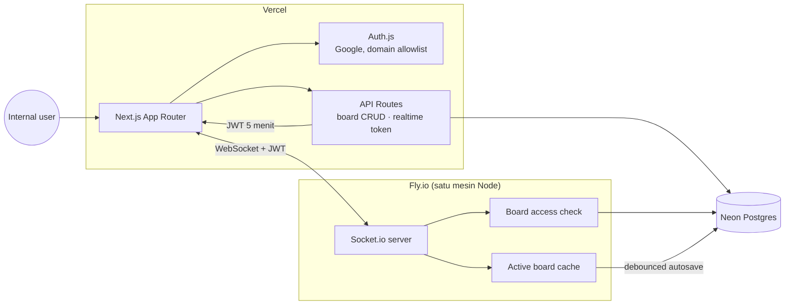

# Roadmap & Keputusan Teknis — SyncCanvas

Dokumen ini menjawab satu pertanyaan: **setelah MVP anonim ini, apa langkah berikutnya?**

Konteks produk (per Oktober 2026):

- Pengguna: **internal**, belum publik.
- Model akses: **workspace** (anggota workspace bisa mengakses board di dalamnya).
- Fitur kanvas: **freehand** dan **sticky notes**.
- Target deploy: **Vercel**.
- Belum ada requirement auth, database, atau branding.

## 1. Keputusan #1 — topologi deployment

### Fakta yang berubah

Sejak **20 Oktober 2026**, WebSocket di Vercel Functions sudah **generally available** (beta sejak Juni 2026). Jadi pernyataan lama “Vercel tidak bisa WebSocket” tidak berlaku lagi. Namun ada batasan yang sangat relevan untuk whiteboard:

| Batasan Vercel Functions                                                                                             | Dampak ke SyncCanvas                                                                                |
| -------------------------------------------------------------------------------------------------------------------- | --------------------------------------------------------------------------------------------------- |
| Koneksi ditutup saat fungsi mencapai durasi maksimum: 300 detik (default), 800 detik (Pro), 1.800 detik (beta)       | Semua peserta **reconnect setiap 5–13 menit**. Presence berkedip dan coretan bisa terputus sesaat   |
| Satu koneksi “dipin” ke satu instance; instance tidak berbagi memori                                                 | `RoomService` in-memory dan Socket.io adapter bawaan **tidak cukup**; wajib Redis (state + pub/sub) |
| Setiap koneksi aktif menagih provisioned memory                                                                      | Board yang dibiarkan terbuka terus menagih biaya, berbeda dari satu mesin Node yang idle            |
| Socket.io harus memakai `transports: ['websocket']` dan path khusus; Next.js butuh `experimental_upgradeWebSocket()` | Perlu entry point server terpisah dan penyesuaian client                                            |
| Deploy baru: koneksi lama tetap di instance lama sampai tertutup                                                     | Perlu reconnect + resync yang sudah kita miliki, tetapi menambah kompleksitas operasional           |

Referensi: [Vercel WebSockets docs](https://vercel.com/docs/functions/websockets), [changelog GA 20 Okt 2026](https://vercel.com/changelog/websocket-support-is-now-generally-available).

### Pilihan

| Opsi                                                                             | Kelebihan                                                                                        | Kekurangan                                                                 | Cocok bila                                                |
| -------------------------------------------------------------------------------- | ------------------------------------------------------------------------------------------------ | -------------------------------------------------------------------------- | --------------------------------------------------------- |
| **A. Hybrid (dipilih):** Next.js di Vercel + Socket.io di Fly.io + Postgres Neon | Koneksi stabil, arsitektur saat ini hampir tidak berubah, biaya kecil, tanpa Redis di tahap awal | Dua platform, dua pipeline deploy                                          | Internal, <100 pengguna, ingin cepat stabil               |
| **B. Semua di Vercel:** Socket.io sebagai Function + Upstash Redis               | Satu platform, satu tagihan                                                                      | Reconnect periodik, state wajib Redis, biaya koneksi idle, refactor server | Wajib satu platform / traffic kecil dan toleran reconnect |
| **C. Managed realtime** (Liveblocks/Ably)                                        | Tidak mengelola socket server, fitur kolaborasi matang                                           | Vendor lock-in, biaya per user, kontrak event kita ditinggalkan            | Ingin fokus produk, bukan infrastruktur                   |

### Keputusan

**Opsi A untuk sekarang.** Vercel tetap menjadi rumah aplikasi Next.js (UI, auth, API board), sementara proses Socket.io berjalan sebagai satu service Node.js di **Fly.io** (Railway/Render setara). Ini menjaga janji “deploy di Vercel” untuk produk utama tanpa mengorbankan kualitas real-time.

**Revisit trigger:** jika muncul kebutuhan “semua harus di Vercel”, atau penggunaan menembus ±100 pengguna aktif bersamaan, migrasi ke Opsi B (Redis adapter + state di Redis) sudah punya jalur jelas — lihat `ARCHITECTURE.md` bagian scaling.

> Catatan: WebSocket Vercel layak dipakai untuk chat/streaming, tetapi untuk whiteboard yang sesinya panjang, siklus reconnect 5 menit lebih mahal secara UX dan biaya dibanding satu mesin kecil yang hidup terus.

## 2. Arsitektur target



Prinsip:

- **Postgres adalah sumber kebenaran** untuk workspace, board, dan elemen.
- Server realtime hanya menyimpan **cache board aktif** di memori; aman karena satu instance.
- Client tidak pernah dipercaya soal identitas atau akses board: `userId`, nama, dan role berasal dari token/JWT + query DB.
- Board yang tidak aktif tidak menahan memori; cache dibuang setelah idle dan di-flush ke DB.

## 3. Model domain & data

```text
User ──< WorkspaceMember >── Workspace ──< Board ──< BoardElement
```

| Tabel                                         | Kolom penting                                                                                                            | Catatan                                                      |
| --------------------------------------------- | ------------------------------------------------------------------------------------------------------------------------ | ------------------------------------------------------------ |
| `users`                                       | `id`, `name`, `email`, `image`, `email_verified`                                                                         | Diisi Auth.js                                                |
| `accounts`, `sessions`, `verification_tokens` | Skema Auth.js + Drizzle adapter                                                                                          | Sesi database agar bisa dicabut                              |
| `workspaces`                                  | `id`, `name`, `slug`, `created_by`                                                                                       | Internal: satu workspace default, model siap multi-workspace |
| `workspace_members`                           | `workspace_id`, `user_id`, `role` (`OWNER`/`MEMBER`)                                                                     | Akses board = keanggotaan workspace                          |
| `boards`                                      | `id`, `workspace_id`, `title`, `revision`, `created_by`, `created_at`, `updated_at`                                      | Board list & metadata                                        |
| `board_elements`                              | `id`, `board_id`, `type` (`STROKE`/`NOTE`), `data jsonb`, `z_index`, `version`, `created_by`, `created_at`, `updated_at` | Satu tabel untuk semua objek kanvas                          |

Contoh `data`:

```jsonc
// type = STROKE
{ "tool": "pen", "color": "#7c9cff", "width": 3, "points": [{ "x": 10, "y": 20 }] }

// type = NOTE
{ "x": 320, "y": 180, "width": 220, "height": 160, "text": "Ide…", "color": "#facc15" }
```

Alasan memilih `board_elements` ketimbang satu snapshot JSONB per board:

- Update catatan tidak perlu menulis ulang seluruh board.
- `version` per elemen memungkinkan deteksi konflik.
- Siap menampung shapes/gambar tanpa migrasi besar.
- Masih cukup sederhana untuk MVP.

Batas yang dipertahankan: 256 titik/batch, 20.000 titik/stroke, 2.000 elemen/board.

## 4. Autentikasi & otorisasi

### Login

- **Auth.js (NextAuth v5)** dengan provider **Google**, dibatasi domain perusahaan.
- Callback `signIn` menolak email di luar domain dan email yang tidak diundang.
- Sesi disimpan di Postgres (bukan JWT cookie) agar bisa dicabut.
- Halaman `/login`; seluruh route board dilindungi middleware.

> Jika internal memakai Microsoft 365, ganti provider ke Entra ID. Struktur dan alur tidak berubah.

### Otorisasi realtime

Auth.js session cookie tidak praktis dikirim ke domain Socket.io yang berbeda, jadi:

1. Client memanggil `POST /api/realtime-token` (session cookie).
2. Route memverifikasi sesi + keanggotaan workspace, lalu menandatangani **JWT 5 menit** (`sub`, `email`, `name`, `aud: synccanvas-ws`).
3. Client: `io(WS_URL, { auth: { token }, transports: ['websocket'] })`.
4. Server: verifikasi JWT di `io.use()`, isi `socket.data`, lalu saat `board:join` cek akses board ke DB (di-cache per socket).
5. Nama peserta diambil dari token — **hapus `displayName` dari payload join** agar tidak bisa dipalsukan.

Token pendek + reconnect otomatis membuat pencabutan akses berlaku cepat tanpa menambah round-trip per event.

## 5. Sticky notes — kontrak yang disiapkan

| Event          | Arah | Payload                                   | Catatan                                                                |
| -------------- | ---- | ----------------------------------------- | ---------------------------------------------------------------------- |
| `note:create`  | C→S  | `{ boardId, noteId, x, y }`               | Ack `{ noteId }`; server set `zIndex` tertinggi                        |
| `note:created` | S→C  | `NoteElement`                             | Broadcast ke peserta lain                                              |
| `note:update`  | C→S  | `{ boardId, noteId, baseVersion, patch }` | Patch: `text`, `color`, `width`, `height`, `x`, `y`; ack `{ version }` |
| `note:updated` | S→C  | `NoteElement`                             | Jika `baseVersion` basi → `NOTE_CONFLICT` + kirim state terbaru        |
| `note:move`    | C→S  | `{ boardId, noteId, x, y }`               | Throttle 50 ms saat drag; broadcast `volatile`, tidak menaikkan versi  |
| `note:moved`   | S→C  | `{ noteId, x, y }`                        | Live drag saja                                                         |
| `note:delete`  | C→S  | `{ boardId, noteId }`                     | Ack; broadcast `note:deleted`                                          |

Strategi konflik:

- **LWW + optimistic concurrency**: update membawa `baseVersion`; server menolak versi basi.
- Client yang kalah menerima state terbaru dan menampilkan notifikasi halus (“catatan diperbarui peserta lain”).
- Belum memakai CRDT; concurrent text editing pada catatan yang sama adalah kasus langka untuk internal.

UI:

- Toolbar “Note” → klik kanan/klik area kosong → catatan 220×160, langsung fokus.
- Catatan dirender sebagai **HTML overlay** di atas SVG (bukan `foreignObject`) agar input teks, IME, dan aksesibilitas lebih baik.
- Drag, resize, ubah warna, hapus, bring-to-front.
- Sinkron teks di-debounce 400 ms dan di-flush saat blur.

## 6. Sprint plan

Estimasi untuk satu developer full-time; kalikan bila paruh waktu.

### Sprint 1 — Identity, workspace, board shell (±4 hari) — SELESAI

- [x] Tambah `packages/db` (Drizzle + PostgreSQL), schema, migration, seed otomatis.
- [x] Auth.js Google + allowlist email/domain + halaman login.
- [x] Guard server-side di layout/page/server action; workspace default otomatis untuk user internal.
- [x] Board list (`/w/[workspaceSlug]`): buat, rename, hapus, buka board.
- [x] Route board terproteksi; editor realtime menyusul di Sprint 2.
- [x] Database lokal PGlite + login development untuk verifikasi tanpa kredensial Google.

**Definition of done:** hanya email allowlisted yang bisa login; user melihat board milik workspace-nya; user luar workspace mendapat 404; data bertahan di PostgreSQL. Catatan: email yang tersedia saat ini `@gmail.com`, sehingga allowlist memakai email persis, bukan domain Google Workspace.

### Sprint 2 — Realtime ber-otorisasi + persistensi (±4 hari)

- [ ] `POST /api/realtime-token` + verifikasi JWT di Socket.io.
- [ ] Rename kontrak `room:*` → `board:*`; hapus `displayName` dari payload join.
- [ ] Cek keanggotaan board saat join + cache per socket.
- [ ] `BoardRepository`: hydrate board saat peserta pertama join, autosave debounce, flush saat stroke selesai / peserta terakhir keluar / shutdown.
- [ ] SSR initial snapshot untuk first paint; realtime tetap sumber sinkronisasi.
- [ ] Integration test dua client: join, gambar, leave, reconnect, unauthorized.

**Definition of done:** board bertahan setelah server restart; socket tanpa token/akses ditolak; tidak ada write DB per titik; dua tab tetap sinkron.

### Sprint 3 — Sticky notes (±5 hari)

- [ ] Schema & event catatan (tabel di atas) + error `NOTE_NOT_FOUND`, `NOTE_CONFLICT`.
- [ ] Overlay HTML, create/edit/drag/resize/color/delete/z-order.
- [ ] Debounce teks, flush saat blur, optimistic update + rollback.
- [ ] Presence indikator “sedang diedit” opsional (nice-to-have).
- [ ] Test: create/update/move/delete lintas client, konflik versi, reload.

**Definition of done:** catatan muncul <300 ms di client lain, teks tidak hilang setelah reload, konflik tidak menimpa diam-diam.

### Sprint 4 — Deploy & hardening (±3 hari)

- [ ] Vercel: client + API + auth; env production; domain.
- [ ] Fly.io: Dockerfile server, `fly.toml`, health check, region dekat Neon.
- [ ] Neon: pooled connection, backup, migration di CI.
- [ ] CORS allowlist (production + staging), JWT secret rotation.
- [ ] CI: typecheck, test, build; deploy terkontrol.
- [ ] Monitoring: log drain + alert error rate (Sentry opsional).
- [ ] Runbook singkat di README (deploy, rollback, restore DB).

**Definition of done:** alur penuh berjalan di URL staging; reconnect 5+ menit stabil; rollback dan restore terdokumentasi.

## 7. Ditunda secara sadar

- Pan/zoom & infinite canvas (fixed board dulu; ini kandidat Sprint 5).
- Shapes, gambar, komentar, template.
- Undo/redo (butuh model operasi; jangan dipaksakan sebelum notes stabil).
- CRDT/offline editing.
- Public share link, viewer role, billing.
- Multi-instance Redis (baru perlu bila Opsi B atau trafik naik).

## 8. Risiko & mitigasi

| Risiko                              | Dampak                                             | Mitigasi                                                        |
| ----------------------------------- | -------------------------------------------------- | --------------------------------------------------------------- |
| Salah pilih topologi (semua Vercel) | Reconnect tiap 5 menit, biaya idle, refactor Redis | Putuskan sekarang: hybrid                                       |
| Autosave terlalu sering             | Write amplification ke Neon                        | Debounce 1–2 detik; flush pada event diskrit; ukur              |
| Konflik edit catatan                | Teks tertimpa                                      | `baseVersion` + notifikasi; lock opsional                       |
| Domain allowlist bocor              | Orang luar domain masuk                            | Cek `hd`/domain di server, undangan eksplisit, audit login      |
| Preview deployment Vercel           | CORS/WS token beda origin                          | Staging tetap; allowlist eksplisit, bukan wildcard              |
| Data hilang saat deploy             | Board aktif belum ter-flush                        | Flush on SIGTERM + healthcheck drain; Fly stop timeout          |
| Board membengkak                    | JSONB besar, render lambat                         | Batas elemen/titik; arsip board; renderer canvas di fase lanjut |

## 9. Langkah paling dekat

Sprint 1 sudah diimplementasikan. Langkah berikutnya:

1. `POST /api/realtime-token` + verifikasi JWT di Socket.io.
2. Rename kontrak `room:*` → `board:*` dan hapus `displayName` dari payload join.
3. `BoardRepository`: hydrate saat join, simpan saat `stroke:end`, hapus saat clear.
4. SSR snapshot awal board.

**Yang masih dibutuhkan sebelum staging:** Google OAuth Client ID/Secret, `DATABASE_URL` Neon, dan `AUTH_SECRET` produksi. Email `@gmail.com` memakai allowlist email persis; jika nanti memakai Google Workspace, isi `ALLOWED_EMAIL_DOMAINS`.
